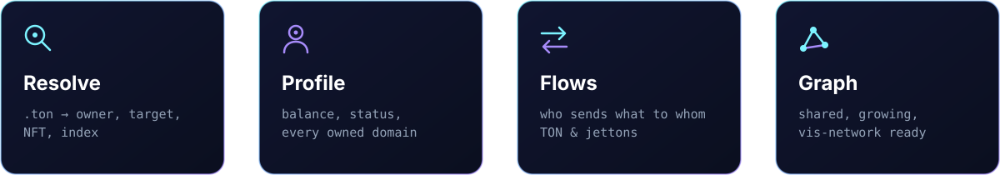
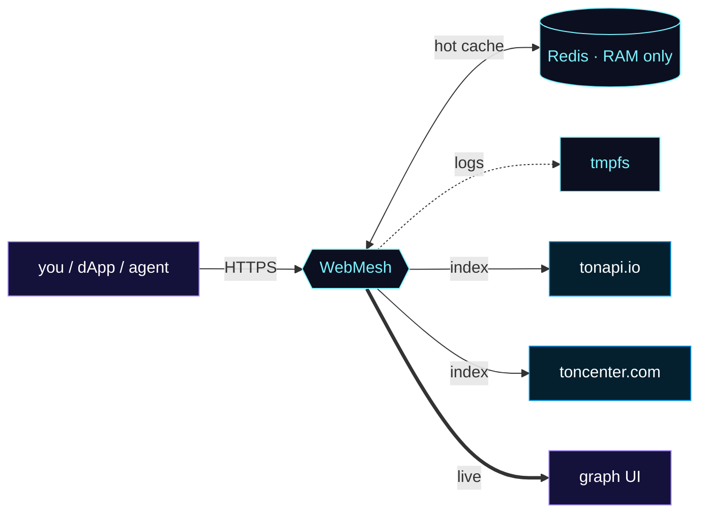

<div align="center">

 <a href="https://webmesh.cc">
  
</a>

 <a href="https://webmesh.cc"></a>

<br>

[](https://webmesh.cc)
[](https://webmesh.cc/openapi.json)
[](https://ton.org)
[](#quick-start)

<br>

[**Quick start**](#quick-start) &nbsp;·&nbsp; [**API**](#api) &nbsp;·&nbsp; [**For AI agents**](#for-ai-agents) &nbsp;·&nbsp; [**Draw the graph**](#draw-the-graph-yourself) &nbsp;·&nbsp; [**Privacy**](#privacy) &nbsp;·&nbsp; [**Roadmap**](#roadmap)

</div>


<div align="center">

### Resolve a `.ton` name. Follow the wallet. Watch the money move.
**One free REST API. No signup. No API key. Every lookup grows a shared map of the TON name space.**

</div>

<br>



<br>

<div align="center">


</div>


## Quick start

Base URL: `https://webmesh.cc`

```bash
# Resolve a .ton name: owner, target, NFT, index
curl https://webmesh.cc/WebMesh/api/resolve/foundation.ton

# Profile by name or address: balance, status, owned domains
curl https://webmesh.cc/WebMesh/api/profile/foundation.ton

# Top counterparties of an address
curl https://webmesh.cc/WebMesh/api/flows/<address>

# The shared graph
curl https://webmesh.cc/WebMesh/api/graph
```

<!-- TODO: paste one real JSON response here (for example /resolve), so readers see the fields at a glance. -->

<br>

## API

| Endpoint | What you get | Limit |
| :-- | :-- | --: |
| `GET /WebMesh/api/resolve/{name}.ton` | owner · target · NFT · index | `20 / min` |
| `GET /WebMesh/api/profile/{name_or_address}` | balance · status · owned domains | `20 / min` |
| `GET /WebMesh/api/flows/{address}` | top-20 counterparties, TON and jettons | `10 / min` |
| `GET /WebMesh/api/graph` | `{ nodes, links }` | `120 / min` |
| `GET /WebMesh/api/health` | `{ ok, redis }` | none |

<!-- TODO: state whether limits are per IP, whether Retry-After is sent, and list the error codes (400 / 404 / 429 / 5xx) with an example error body. -->

Errors are always JSON. A `429` means you hit the rate limit: wait a minute and retry.

<br>

## For AI agents

WebMesh is built to be read by machines as easily as by people. Point your agent at either of these and it will figure out the rest:

| | |
| :-- | :-- |
| **`llms.txt`** | [webmesh.cc/llms.txt](https://webmesh.cc/llms.txt) |
| **OpenAPI 3.0** | [webmesh.cc/openapi.json](https://webmesh.cc/openapi.json) |

<br>

## Draw the graph yourself

<details open>
<summary><b>Ten lines to a live network</b></summary>

<br>

```html
<script src="https://unpkg.com/vis-network/standalone/umd/vis-network.min.js"></script>
<div id="graph" style="height: 600px"></div>
<script>
  fetch('https://webmesh.cc/WebMesh/api/graph')
    .then(r => r.json())
    .then(({ nodes, links }) => {
      const el = document.getElementById('graph');
      const edges = links.map(l => ({ from: l.source, to: l.target }));
      new vis.Network(el, { nodes, edges }, {});
    });
</script>
```

</details>

<br>

## How it flows



<p align="center">
  
  
  
  
</p>


## Privacy

| | |
| :-- | :-- |
| **Shared graph** | Lookups feed a public graph. Anything you resolve may become visible to other users of `/graph`. |
| **Memory-only** | Cache lives in Redis (RAM), logs go to tmpfs. Nothing is written to disk. |
| **No accounts** | No signup, no API keys, no cookies. Read-only: WebMesh never touches your wallet. |

<!-- TODO: confirm how long logs live in tmpfs and whether client IPs are logged. -->

<br>

## Roadmap

| Stage | Status | Progress |
| :-- | :-: | :-- |
| Resolve | Done | `▰▰▰▰▰▰▰▰▰▰` |
| Profiles | Done | `▰▰▰▰▰▰▰▰▰▰` |
| Graph | Done | `▰▰▰▰▰▰▰▰▰▰` |
| Flows | Done | `▰▰▰▰▰▰▰▰▰▰` |
| History | Soon | `▱▱▱▱▱▱▱▱▱▱` |
| Webhooks | Soon | `▱▱▱▱▱▱▱▱▱▱` |
| SDK | Soon | `▱▱▱▱▱▱▱▱▱▱` |

Ideas and bug reports are welcome in [Issues](https://github.com/AuroraAccess/webmesh/issues).

<br>

## License

<!-- TODO: add a LICENSE file and name it here, for example "MIT". The repo currently has none. -->

<br>

<a href="https://webmesh.cc"></a>

<div align="center">


<div align="center">

<br>

### [Open webmesh.cc →](https://webmesh.cc)

If WebMesh is useful to you, star the repo.

<br>

<sub>WebMesh is independent and not affiliated with the TON Foundation or Telegram.<br>Data comes from third-party indexers and may lag the chain.</sub>

</div>
