<div align="center">

<a href="https://webmesh.cc">
  
</a>

</div>

<br>

<details>
<summary><b>Plain-text version</b> &nbsp;·&nbsp; copy-paste commands, endpoint table, notes</summary>

<br>

### Quick start

Base URL: `https://webmesh.cc`

```bash
# Resolve a .ton name: owner, target, NFT, index
curl https://webmesh.cc/WebMesh/api/resolve/foundation.ton

# Profile by name or address: balance, status, owned domains
curl https://webmesh.cc/WebMesh/api/profile/foundation.ton

# Top counterparties of an address
curl https://webmesh.cc/WebMesh/api/flows/<address>

# The shared graph
curl https://webmesh.cc/WebMesh/api/graph
```

<!-- TODO: paste one real JSON response here (for example /resolve), so readers see the fields at a glance. -->

### API

| Endpoint | What you get | Limit |
| :-- | :-- | --: |
| `GET /WebMesh/api/resolve/{name}.ton` | owner · target · NFT · index | `20 / min` |
| `GET /WebMesh/api/profile/{name_or_address}` | balance · status · owned domains | `20 / min` |
| `GET /WebMesh/api/flows/{address}` | top-20 counterparties, TON and jettons | `10 / min` |
| `GET /WebMesh/api/graph` | `{ nodes, links }` | `120 / min` |
| `GET /WebMesh/api/health` | `{ ok, redis }` | none |

<!-- TODO: state whether limits are per IP, whether Retry-After is sent, and list the error codes (400 / 404 / 429 / 5xx) with an example error body. -->

Errors are always JSON. A `429` means you hit the rate limit: wait a minute and retry.

### For AI agents

Point your agent at [`webmesh.cc/llms.txt`](https://webmesh.cc/llms.txt) or the [OpenAPI spec](https://webmesh.cc/openapi.json).

### Draw the graph yourself

```html
<script src="https://unpkg.com/vis-network/standalone/umd/vis-network.min.js"></script>
<div id="graph" style="height: 600px"></div>
<script>
  fetch('https://webmesh.cc/WebMesh/api/graph')
    .then(r => r.json())
    .then(({ nodes, links }) => {
      const el = document.getElementById('graph');
      const edges = links.map(l => ({ from: l.source, to: l.target }));
      new vis.Network(el, { nodes, edges }, {});
    });
</script>
```

### Privacy

- **Shared graph.** Lookups feed a public graph. Anything you resolve may become visible to other users of `/graph`.
- **Memory-only.** Cache lives in Redis (RAM), logs go to tmpfs. Nothing is written to disk.
- **No accounts.** No signup, no API keys, no cookies. Read-only: WebMesh never touches your wallet.

<!-- TODO: confirm how long logs live in tmpfs and whether client IPs are logged. -->

### Roadmap

Done: resolve, profiles, graph, flows. Soon: history, webhooks, SDK.
Ideas and bug reports are welcome in [Issues](https://github.com/AuroraAccess/webmesh/issues).

### License

<!-- TODO: add a LICENSE file and name it here, for example "MIT". The repo currently has none. -->

</details>

<br>

<div align="center">
<sub>WebMesh is independent and not affiliated with the TON Foundation or Telegram. Data comes from third-party indexers and may lag the chain.</sub>
</div>
