<a href="https://webmesh.cc"></a>

<div align="center">

<a href="https://webmesh.cc"></a>

<br/>

<a href="https://webmesh.cc"></a>
<a href="https://webmesh.cc/openapi.json"></a>
<a href="https://ton.org"></a>


</div>

<br/>

<table>
<tr>
<td width="50%" valign="top">

### 🕸️ The idea

Every `.ton` name is a door. Behind it — a wallet, behind the wallet — other names, other wallets, other flows of value.

**WebMesh opens those doors** and stitches everything it sees into one living graph. Each lookup by anyone makes the map a little bigger.

> *Read-only. Memory-only. Nobody's permission required.*

</td>
<td width="50%" valign="top">

### ⚡ In numbers

```text
 endpoints ........ 5
 api keys ......... 0
 disk writes ...... 0   (RAM + tmpfs)
 signup ........... never
 cors ............. open
 llm-ready ........ yes (llms.txt)
```

</td>
</tr>
</table>

<div align="center">

</div>

## 🧬 Superpowers

<table>
<tr>
<td align="center" width="25%"><h1>🔎</h1><b>Resolve</b><br/><sub>.ton → owner, target,<br/>NFT, index</sub></td>
<td align="center" width="25%"><h1>👤</h1><b>Profile</b><br/><sub>balance, status,<br/>every owned domain</sub></td>
<td align="center" width="25%"><h1>💸</h1><b>Flows</b><br/><sub>who sends what<br/>to whom — TON & jettons</sub></td>
<td align="center" width="25%"><h1>🕸️</h1><b>Graph</b><br/><sub>shared, growing,<br/>vis-network ready</sub></td>
</tr>
</table>

## 🛰️ How it flows

```mermaid
flowchart LR
    classDef you fill:#14123a,stroke:#a78bfa,color:#fff
    classDef core fill:#0b0f1f,stroke:#7cf3ff,color:#7cf3ff
    classDef ext fill:#04202e,stroke:#0098ea,color:#fff
    U["🧑‍💻 you / dApp / 🤖 agent"]:::you -->|HTTPS| G{{"🕸️ WebMesh"}}:::core
    G <-->|"⚡ hot cache"| R[("Redis · RAM only")]:::core
    G -.->|"logs"| T["tmpfs"]:::core
    G -->|"index"| A["tonapi.io"]:::ext
    G -->|"index"| C["toncenter.com"]:::ext
    G ==>|"live"| V["🌐 graph UI"]:::you
```



## 📡 The API, in one breath

<details open>
<summary><b>Endpoints</b></summary>

<br/>

| | Endpoint | What you get | Rate |
|:-:|---|---|:-:|
| 🔎 | `GET /WebMesh/api/resolve/{name}.ton` | owner · target · NFT · index | `20/m` |
| 👤 | `GET /WebMesh/api/profile/{name\|addr}` | balance · status · domains | `20/m` |
| 💸 | `GET /WebMesh/api/flows/{addr}` | top-20 counterparties | `10/m` |
| 🕸️ | `GET /WebMesh/api/graph` | `{ nodes, links }` | `120/m` |
| 💚 | `GET /WebMesh/api/health` | `{ ok, redis }` | — |

</details>

<details>
<summary><b>🤖 For AI agents</b></summary>

<br/>

Point your agent at [`webmesh.cc/llms.txt`](https://webmesh.cc/llms.txt) or the [OpenAPI spec](https://webmesh.cc/openapi.json) — it'll figure out the rest. Errors are always JSON; `429` means *breathe for a minute*.

</details>

<details>
<summary><b>🎨 Draw the graph yourself</b></summary>

<br/>

```js
const { nodes, links } = await fetch('https://webmesh.cc/WebMesh/api/graph').then(r => r.json());
new vis.Network(el, { nodes, edges: links.map(l => ({ from: l.source, to: l.target })) }, {});
```

</details>

## 🧱 Made of

<div align="center">


</div>

## 🗺️ Trajectory

```text
 ●━━━━━━━━━●━━━━━━━━━●━━━━━━━━━●━━━━━━━━━○━━━━━━━━━○━━━━━━━━━○
 resolve   profiles  graph     flows     history   webhooks  sdk
 ✓         ✓         ✓         ✓         soon      soon      soon
```

<br/>

<div align="center">

<sub>WebMesh is independent and not affiliated with the TON Foundation or Telegram. Data comes from third-party indexers and may lag the chain.</sub>

<br/><br/>

**[✦ open webmesh.cc ✦](https://webmesh.cc)**

<sub>if this sparked something — leave a ⭐</sub>

</div>
